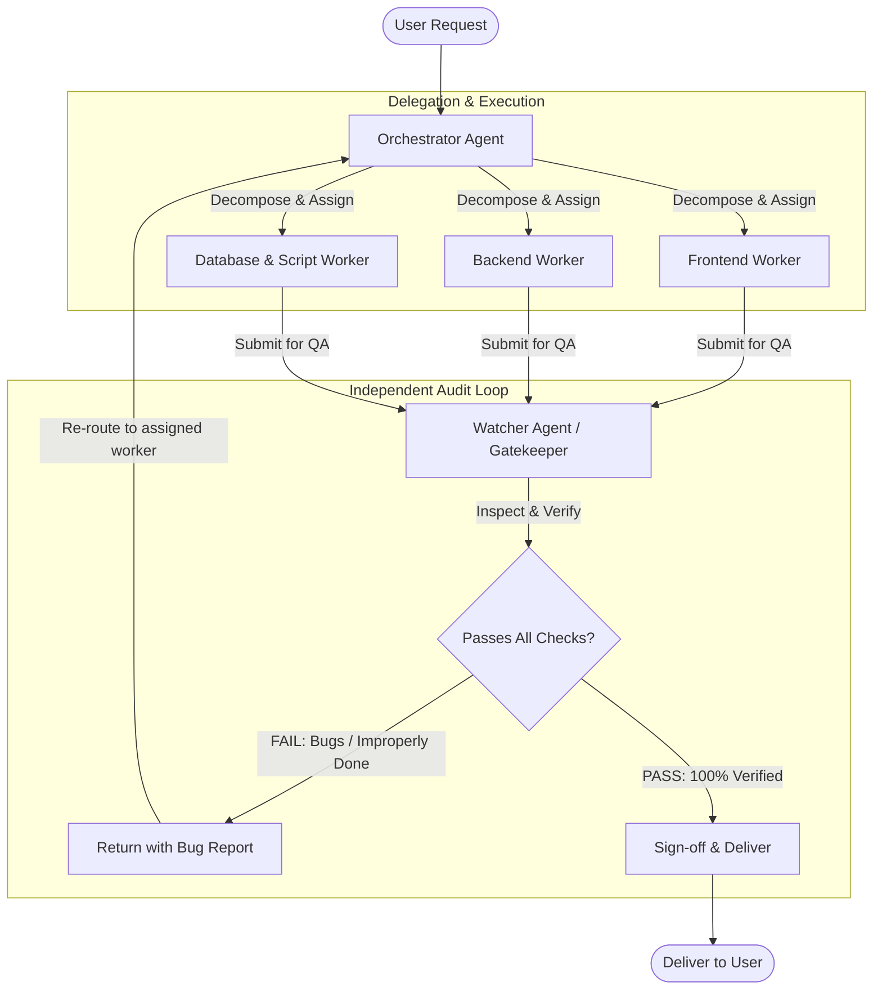

# Multi-Agent Orchestration & Quality Assurance Architecture

This project operates under a hierarchical **Multi-Agent System (MAS)** consisting of an **Orchestrator Agent**, domain **Worker Agents**, and an independent **Watcher (QA Gatekeeper) Agent**.

---

## 1. Multi-Agent Topology & Workflow

---

## 2. Core Agent Roles

### A. The Orchestrator Agent (`.agents/rules/orchestrator.md`)
- **Authority**: High-level conductor and supervisor.
- **Responsibilities**:
  1. Ingests user requests, parses intent, and establishes clear task acceptance criteria.
  2. Breaks complex tasks into modular, parallelizable work units.
  3. Assigns work to specialized Worker Agents (Frontend, Backend, Database).
  4. Maintains project state, tracking progress, open bugs, and iteration counts.
  5. Never delivers work to the user without formal sign-off from the **Watcher Agent**.

### B. Worker Agents (Domain Specialists)
- **Frontend Specialist**: React, Next.js, TypeScript, Tailwind/Vanilla CSS, responsive UI/UX, accessibility.
- **Backend Specialist**: FastAPI, Python, SQLAlchemy ORM, SQLite/PostgreSQL, authentication, business logic.
- **Data & Migration Specialist**: Excel parser, database migrations, seed scripts, audit logs.
- **Operating Rule**: Workers must implement solutions completely, self-test changes, and submit deliverables to the Watcher for formal inspection.

### C. The Watcher Agent (`.agents/rules/watcher.md`)
- **Authority**: Independent QA Inspector and Code Gatekeeper.
- **Responsibilities**:
  1. Intercepts any completed work before user delivery.
  2. Executes rigorous validation gates:
     - **Static Analysis**: TypeScript compilation, ESLint, syntax, type safety.
     - **Runtime Health**: Dev server responsiveness, HTTP status 200 checks, backend API contracts.
     - **UI/UX Integrity**: No squished cards, no text clippings, proper contrast, responsive breakpoints.
     - **Regression Guard**: Verifies existing features (attendance, seating, follow-up, room allocations) remain intact.
  3. **Rejection Authority**: If any bug, inconsistency, or incomplete requirement is found, the Watcher immediately **rejects** the deliverable, produces a structured bug report, and sends it back to the Orchestrator to re-assign for remediation.
  4. **Approval Authority**: Only when all verification gates pass with zero errors does the Watcher sign off for delivery.

---

## 3. Dedicated Rule Files

Detailed operational directives and standard operating procedures are maintained in:
- [Orchestrator Protocol](file:///c:/Users/tomar/Downloads/EduDuty/.agents/rules/orchestrator.md)
- [Watcher QA Protocol](file:///c:/Users/tomar/Downloads/EduDuty/.agents/rules/watcher.md)
