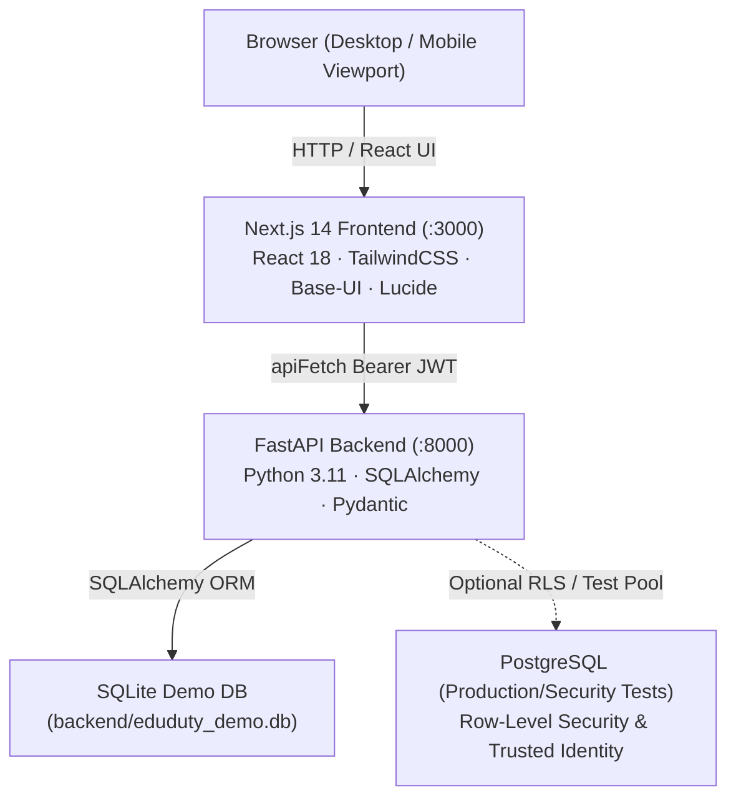

# EduDuty — Mid-Semester Test (MST) Operations Portal

EduDuty is a full-stack academic operations portal designed to streamline institutional examination logistics, midterm invigilation scheduling, attendance eligibility compliance, dual-absence follow-ups, and AI-assisted academic reporting.

---

## 1. Project Purpose & Main Features

- **Role-Aware Dashboards:** Dedicated dashboards tailored to Exam Coordinators, Faculty Members, Super Admins, and Viewers.
- **Attendance & Eligibility Tracking:** Automated calculation of midterm eligibility thresholds with granular coordinator override capabilities.
- **Dual-Absence Follow-Up:** Identification and tracking of students absent for multiple consecutive examinations with follow-up status resolution.
- **Invigilation Duty Scheduling:** Assignment of faculty members to exam rooms and time slots, taking into account departmental roles and lecture commitments.
- **Exam Roll Call & Seating Arrangement:** Real-time attendance verification for invigilators during examination sessions.
- **AI-Powered Academic Insights:** Natural language querying of institutional attendance and duty rosters with server-side role enforcement and read/write separation.
- **Responsive Navigation:** Accessible slide-over drawer navigation on mobile viewports (< 768px) and sidebar on desktop viewports.

---

## 2. Architecture & Technology Stack



### Technology Stack
- **Frontend:** Next.js 14 (App Router), React 18, TailwindCSS, Base-UI, Lucide React, TypeScript.
- **Backend:** FastAPI, Python 3.11, SQLAlchemy 2.0, Pydantic, Uvicorn.
- **Authentication:** Dual-mode authentication architecture:
  1. Supabase Auth (Native Bearer JWT with HMAC-SHA256 signature verification).
  2. Safe Local Dev Demo Authentication (predefined development identities strictly gated by environment flags).
- **Database:**
  - Local Dev & Demo: SQLite (`backend/eduduty_demo.db`).
  - Production / Security Testing: PostgreSQL 16 with Row-Level Security (RLS) and HMAC-signed trusted identity context.

---

## 3. Prerequisites & Installation

### Prerequisites
- **Python:** 3.11+
- **Node.js:** v18+ with `npm`
- **PowerShell:** Windows PowerShell 5.1 or PowerShell 7+
- **Docker:** (Optional) Only required when running PostgreSQL RLS security test suites.

### Installation Steps

1. **Clone repository and navigate to root:**
   ```powershell
   cd d:\Code\eduduty
   ```

2. **Backend Setup:**
   ```powershell
   # Create and activate virtual environment (optional but recommended)
   python -m venv backend/.venv
   backend/.venv/Scripts/Activate.ps1

   # Install dependencies
   pip install -r backend/requirements.txt

   # Create backend/.env from the example template
   Copy-Item backend/.env.example backend/.env
   # Or on macOS/Linux: cp backend/.env.example backend/.env
   ```

3. **Frontend Setup:**
   ```powershell
   cd frontend
   npm install
   cd ..
   ```

---

## 4. Environment Configuration

Environment files store configuration settings. **Never commit real credentials or production signing secrets to version control.**

Before starting the application, create `backend/.env` from `backend/.env.example`:
```powershell
Copy-Item backend/.env.example backend/.env
# On macOS / Linux:
# cp backend/.env.example backend/.env
```

`backend/.env`, `backend/eduduty.db`, and `backend/eduduty_demo.db` are excluded from Git via `.gitignore`.

### Backend (`backend/.env`)
| Variable | Description | Default / Example |
|---|---|---|
| `DATABASE_URL` | SQLAlchemy connection string. Points to the demo SQLite DB for local dev. | `sqlite:///./eduduty_demo.db` |
| `ENVIRONMENT` | Environment mode (`development` or `production`). | `development` |
| `APP_ENV` | Application environment gate. Set to `production` in production. | `development` |
| `ENABLE_DEV_DEMO_AUTH` | Enables development-only demo accounts on `/auth/demo-login`. Automatically disabled if `APP_ENV=production`. | `true` |
| `SUPABASE_JWT_SECRET` | Secret key used to verify Supabase JWT signatures (min 16 characters). | Placeholder for dev |
| `SUPABASE_JWT_ISSUER` | Expected JWT issuer claim (`iss`). | `https://test.supabase.co/auth/v1` |
| `SUPABASE_JWT_AUDIENCE`| Expected JWT audience claim (`aud`). | `authenticated` |
| `GROQ_API_KEY` | Optional API key for Groq AI inference. | *(optional)* |
| `GEMINI_API_KEY` | Optional API key for Google Gemini AI inference. | *(optional)* |

### Frontend (`frontend/.env.local`)
| Variable | Description | Default / Example |
|---|---|---|
| `NEXT_PUBLIC_API_URL` | Base URL of the FastAPI backend. | `http://localhost:8000` |
| `NEXT_PUBLIC_SUPABASE_URL` | Public URL for Supabase project (if using Supabase Auth). | `http://localhost:54321` |
| `NEXT_PUBLIC_SUPABASE_ANON_KEY` | Supabase anon key (safe for public client exposure). | *(optional in demo mode)* |

---

## 5. One-Command Development Startup

The repository includes a PowerShell startup script `start-dev.ps1` at the root.

### Starting Services
```powershell
.\start-dev.ps1
```

**What it does:**
1. Checks for port conflicts on `8000` and `3000` and reports actionable remediation if occupied.
2. Validates that `backend/eduduty_demo.db` exists and is selected.
3. Detects Python runtime (virtual environment or system) and verifies required packages.
4. Checks Node.js runtime and validates `frontend/node_modules`.
5. Spawns two independent terminal windows for backend and frontend so logs remain visible.
6. Polls backend health (`http://127.0.0.1:8000/health`) and frontend readiness (`http://127.0.0.1:3000/login`) with bounded timeouts.
7. Prints a summary banner with clickable demo personas.

### Stopping Services
```powershell
.\start-dev.ps1 -Stop
```
Or simply close the two spawned terminal windows.

---

## 6. Local URLs & Health Checks

| Service | URL | Expected Response |
|---|---|---|
| **Web Portal** | `http://127.0.0.1:3000/login` | HTTP 200 (Login page with demo login cards) |
| **Backend Health** | `http://127.0.0.1:8000/health` | `{"status": "ok", "environment": "development"}` |
| **Auth Status** | `http://127.0.0.1:8000/auth/status` | `{"supabase_configured": true, "demo_auth_enabled": true, ...}` |
| **Interactive API Docs** | `http://127.0.0.1:8000/docs` | Swagger UI with OpenAPI specification |

---

## 7. Demo Personas & Permissions

When `ENABLE_DEV_DEMO_AUTH=true` is configured in development, clicking any demo persona on the `/login` screen automatically signs you in:

| Persona | Demo Account Email | Intended Role | Key Capabilities |
|---|---|---|---|
| **Exam Coordinator** | `coord@eduduty.ac.in` | `EXAM_COORDINATOR` | Full exam status, eligibility overrides, duty scheduling, dual-absence alerts, attendance imports. |
| **Faculty Member** | `faculty@eduduty.ac.in` | `FACULTY` | Personal invigilation duties, assigned teaching commitments, exam roll-call. (Upload Attendance and Settings hidden). |
| **Super Admin** | `admin@eduduty.ac.in` | `SUPER_ADMIN` | System administration, AI & infrastructure metrics, global RBAC management. |
| **Read-Only Viewer** | `viewer@eduduty.ac.in` | `VIEWER` | Observational read-only mode, institutional metrics, class breakdowns. Mutation routes and action buttons omitted. |

---

## 8. Running Tests & Validation

### Backend Regression Tests
To run the automated test suite against the SQLite database:
```powershell
cd backend
python -m pytest tests/ -v -k "not postgres"
```
*Current test result: 95 passed, 8 skipped, 82 deselected.*

### PostgreSQL-Gated Security Tests
*Note: Requires Docker container `eduduty_pg_b4_test` running on port 5433.*
```powershell
cd backend
python -m pytest tests/test_postgres_rls_*.py -v
```

### Frontend Lint & Build
```powershell
cd frontend

# Run ESLint checks
npm run lint

# Run Next.js production compilation
npm run build
```

---

## 9. Databases: Demo DB vs. Original DB

| Database | Path | Size | Description |
|---|---|---|---|
| **Original Database** | `backend/eduduty.db` | Exactly 180,224 bytes | **Preserved untouched byte-for-byte.** Initial repository database schema with 0 rows. Never modified or overwritten. |
| **Demo Database** | `backend/eduduty_demo.db` | ~196,608 bytes | Seeded development database containing 105 realistic institutional records across 12 tables (exams, classes, students, duties, timetables, and audit logs). Used by default for all local development. |

To regenerate or re-seed the demo database at any time:
```powershell
cd backend
python seed_demo_data.py
```

---

## 10. Troubleshooting

- **Port 8000 or 3000 Already in Use:**
  Run `.\start-dev.ps1 -Stop` to terminate orphaned processes. Alternatively, in PowerShell:
  `Stop-Process -Id (Get-NetTCPConnection -LocalPort 8000 -State Listen).OwningProcess -Force`
- **Missing Python Packages:**
  Ensure your virtual environment is active or run:
  `pip install -r backend/requirements.txt`
- **Missing Frontend Packages:**
  Run `cd frontend && npm install`.
- **Supabase Local Service Offline:**
  EduDuty automatically falls back to development demo authentication when Supabase is not running. Single-click login on `/login` works out of the box.
- **Missing Backend Environment Configuration:**
  If `backend/.env` is missing, copy the template before launching:
  `Copy-Item backend/.env.example backend/.env`
- **Database URL Warning:**
  Verify that `backend/.env` contains `DATABASE_URL=sqlite:///./eduduty_demo.db`. Never set it to `eduduty.db`.

---

## 11. Current Limitations & Production Deployment Cautions

1. **Development Demo Authentication:**
   Demo authentication (`/auth/demo-login`) is strictly designed for local development. In any production deployment, `APP_ENV=production` and `ENABLE_DEV_DEMO_AUTH=false` must be configured.
2. **Secret Management:**
   Ensure `SUPABASE_JWT_SECRET` is set to your production Supabase project's secret in production. Never commit `.env` files containing production secrets.
3. **Multi-Institution Tenancy:**
   EduDuty is currently configured for single-institution deployment. Multi-tenant partitioning requires institutional tenant scoping.
4. **Teaching vs. Exam Schedule Overlap Badges:**
   Teaching timetables and invigilation duties are displayed side-by-side on the Faculty dashboard; automated visual warning badges for overlapping time intervals can be expanded in future versions.
