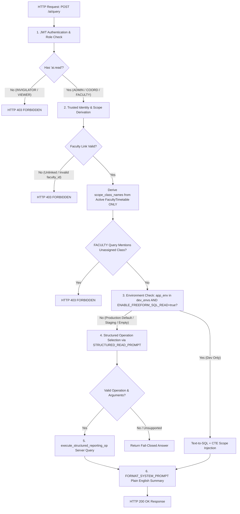

# EduDuty — Phase 2 Stage B3.3.9: AI Authorization Policy & Implementation Gate

**Date:** October 10, 2026  
**Status:** Stage B3.3.9 Complete  
**Gate Verdict:** **PASS**  
**Scope:** Implementation of Approved Authorization Policies (Active Faculty Class Scope Only, Institution-Wide Duty Roster Access for Faculty, Viewer AI Access Restriction), Integration Regression Validation, and Stage B4 Readiness Handoff  
**Test Suite Verdict:** **`86 PASSED, 0 FAILED`** (in 28.92s)

---

## 1. Approved Authorization Policies & Implementation Details

### Policy 1: Active Faculty Class Assignments Only
- **Requirement:** Faculty class scope must be derived exclusively from active `FacultyTimetable` assignments. Historical `AttendanceRecord` uploads must never independently grant class scope access. Removing or ending a timetable assignment must immediately revoke class scope on subsequent requests.
- **Code Implementation:** Updated [backend/main.py:820-835](file:///d:/Code/eduduty/backend/main.py#L820-L835) to query `models.FacultyTimetable` (joining `models.TimetableVersion` where `active == True` or `timetable_version_id` is null). The legacy `AttendanceRecord` query was **completely removed** from scope derivation.
- **Verification Tests:** 
  - `test_b339_active_faculty_class_assignments_only`: Confirmed `AttendanceRecord` alone cannot grant class scope.
  - `test_b339_removing_timetable_assignment_revokes_scope`: Confirmed deleting a `FacultyTimetable` entry immediately revokes scope with `HTTP 403 FORBIDDEN`.

### Policy 2: Faculty May View All Faculty Duty-Roster Entries
- **Requirement:** An authenticated `FACULTY` user with `ai.read` may query the institution-wide faculty duty roster. Remove the requester-name filter from `get_duty_roster` where that filter existed solely to restrict results to the requesting faculty member. Update `get_duty_roster` metadata to `"pii": True` (descriptive metadata, not an access substitute). Access to student-identifiable records remains strictly class-scoped for `FACULTY`.
- **Code Implementation:** 
  - Updated `STRUCTURED_REPORTING_OPS["get_duty_roster"]["pii"]` to `True` in [backend/ai_service.py:294](file:///d:/Code/eduduty/backend/ai_service.py#L294).
  - Removed server-side `user_faculty_name` filtering block from `execute_structured_reporting_op` in [backend/ai_service.py:330-345](file:///d:/Code/eduduty/backend/ai_service.py#L330-L345) and passed `user_faculty_name=None` from [backend/main.py:857](file:///d:/Code/eduduty/backend/main.py#L857).
  - If a user explicitly specifies a `faculty_name` parameter in `args` (e.g. `{"faculty_name": "Prof. Sharma"}`), typed argument filtering applies `LOWER(faculty_name) LIKE LOWER(:arg_fac)`. If unargumented, the institution-wide duty roster is returned.
- **Verification Tests:**
  - `test_b339_faculty_can_view_institution_wide_duty_roster`: Confirmed `FACULTY` users can view duties for all faculty members.
  - `test_b339_duty_roster_policy_does_not_expand_student_reporting_access`: Confirmed student reporting operations (`get_attendance_summary`, `get_eligibility_summary`, `get_vt_candidates`, `get_vt_follow_up_status`) remain strictly restricted to `scope_class_names`.

### Policy 3: Viewer & Invigilator AI Access Remains Blocked
- **Requirement:** `VIEWER` and `INVIGILATOR` roles remain denied `ai.read`. Requests to `/ai/query` by `VIEWER` or `INVIGILATOR` must return `HTTP 403 FORBIDDEN`. No aggregate-only exceptions added.
- **Code Implementation:** Server-side RBAC dependency `require_permission("ai.read")` in [backend/api/dependencies.py:70-82](file:///d:/Code/eduduty/backend/api/dependencies.py#L70-L82) checks `ROLE_PERMISSIONS` in [backend/core/security.py:20-90](file:///d:/Code/eduduty/backend/core/security.py#L20-L90). Neither `VIEWER` nor `INVIGILATOR` possesses `ai.read`.
- **Verification Tests:**
  - `test_b339_viewer_and_invigilator_remains_blocked_http_403`: Confirmed both roles receive `HTTP 403 FORBIDDEN`.

---

## 2. End-to-End Execution Path & Traceability



---

## 3. Structured AI Reporting Operations Catalog

| Operation Name | Target View | Permitted Roles | PII Flag | Scope Controls |
| :--- | :--- | :--- | :--- | :--- |
| `get_eligibility_summary` | `ai_eligibility_summary` | `ADMIN`, `EXAM_COORDINATOR`, `FACULTY` | False | Filtered by server `scope_class_names` |
| `get_attendance_summary` | `ai_attendance_summary` | `ADMIN`, `EXAM_COORDINATOR`, `FACULTY` | True | Filtered by server `scope_class_names` |
| `get_vt_candidates` | `ai_vt_candidates` | `ADMIN`, `EXAM_COORDINATOR`, `FACULTY` | True | Filtered by server `scope_class_names` |
| `get_duty_roster` | `ai_duty_roster` | `ADMIN`, `EXAM_COORDINATOR`, `FACULTY` | True | Institution-wide (optional `faculty_name` argument) |
| `get_vt_follow_up_status` | `v_vt_follow_up_status` | `ADMIN`, `EXAM_COORDINATOR`, `FACULTY` | True | Filtered by server `scope_class_names` |

---

## 4. Test Evidence & Verification Outcome

Executed full backend pytest suite:
```powershell
$env:APP_ENV="test"; python -m pytest tests
```
Result: **`86 PASSED, 0 FAILED`** (in 28.92s).

---

## 5. Distinction Between SQLite Test Evidence and PostgreSQL Readiness

1. **Verified Locally on SQLite (86/86 Passed):**
   - Active `FacultyTimetable` scope derivation.
   - Exclusion of historical `AttendanceRecord` from authorization scope.
   - Dynamic revocation of scope upon assignment removal.
   - Institution-wide duty roster access for authenticated `FACULTY`.
   - Continued class-based scope restriction for student reporting operations.
   - `HTTP 403` rejection of `VIEWER` and `INVIGILATOR` requests.
   - Production disablement of free-form text-to-SQL.
   - Database file `eduduty.db` left 100% untouched.

2. **Not Verified (PostgreSQL Environment Unavailable):**
   - Native PostgreSQL Row-Level Security (`CREATE POLICY ... ON ...`).
   - Session variable injection (`SET LOCAL app.current_user_role = ...`).
   - PostgreSQL RLS view security invoker configuration (`ALTER VIEW ... SET (security_invoker = true)`).
   - Alembic migration `006_add_faculty_id_to_ai_duty_roster.py` execution on live PostgreSQL instance.

---

## 6. Stage B4 Handoff Prerequisites & Verdict

### Final Verdict: **PASS**

All three approved authorization policies have been fully implemented, validated with regression tests, and documented.

- **Prerequisites for Stage B4:**
  1. Provision live PostgreSQL database instance.
  2. Implement Alembic migration `006` to expose `f.id AS faculty_id` on `ai_duty_roster`.
  3. Apply base table RLS policies and `security_invoker` view options in PostgreSQL.
